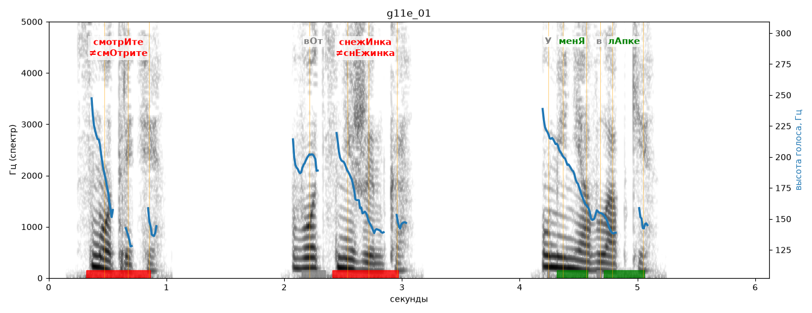

# g11e_01

Голос: **edge:ru-RU-SvetlanaNeural** · длительность 6.1 с
Естественность (UTMOS): **3.8 из 5** (живой диктор ≈ 4–4.5)
Эталон: Смотрите! Вот снежинка! У меня в лапке!
Распознано: Смотрите. Вот снежинка. У меня в лапке.
Слова: все совпали

## Ударения
(где нужно: ruaccent)

| слово | нужно | у голоса | |
|---|---|---|---|
| смотрите | смотрИте | смОтрите | ✗ ОШИБКА |
| снежинка | снежИнка | снЕжинка | ✗ ОШИБКА |
| меня | менЯ | менЯ | ✓ |
| лапке | лАпке | лАпке | ✓ |

## Интонация
- ✗ «смотрите!» — восклицание звучит ровно, без эмоции
- ✓ «вот снежинка!» — выделено слово «вот» (+2.7 пт)
- ✓ «у меня в лапке!» — выделено слово «у» (+5.4 пт)
- Диапазон голоса 8.0 полутонов (живо), средняя высота 167 Гц

## Паузы и темп
- паузы на своих местах
- Темп 5.9 слога/с (нормально)

_Синяя линия — высота голоса. Над словами заглавная буква — где ударение должно быть; красным — голос поставил не туда (уверенно), оранжевым — возможно._
