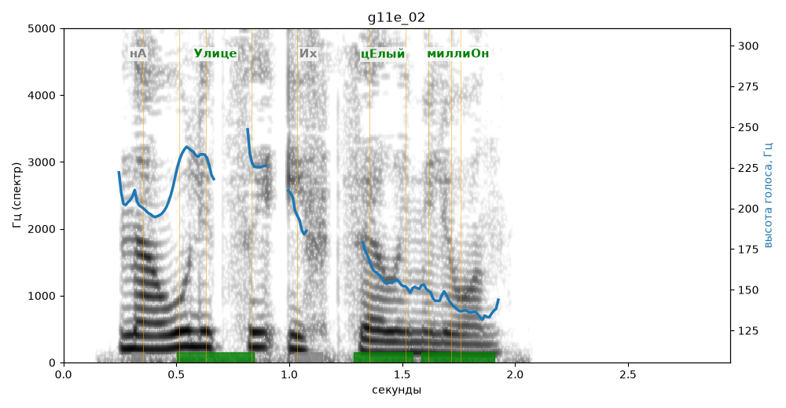

# g11e_02

Голос: **edge:ru-RU-SvetlanaNeural** · длительность 3.0 с
Естественность (UTMOS): **4.04 из 5** (живой диктор ≈ 4–4.5)
Эталон: На улице их целый миллион!
Распознано: На улице их целый миллион.
Слова: все совпали

## Ударения
(где нужно: ruaccent)

| слово | нужно | у голоса | |
|---|---|---|---|
| улице | Улице | Улице | ✓ |
| целый | цЕлый | цЕлый | ✓ |
| миллион | миллиОн | миллиОн | ✓ |

## Интонация
- ✓ «на улице их целый миллион!» — выделено слово «улице» (+3.9 пт)
- Диапазон голоса 9.5 полутонов (живо), средняя высота 182 Гц

## Паузы и темп
- паузы на своих местах
- Темп 7.0 слога/с (быстро)

_Синяя линия — высота голоса. Над словами заглавная буква — где ударение должно быть; красным — голос поставил не туда (уверенно), оранжевым — возможно._
