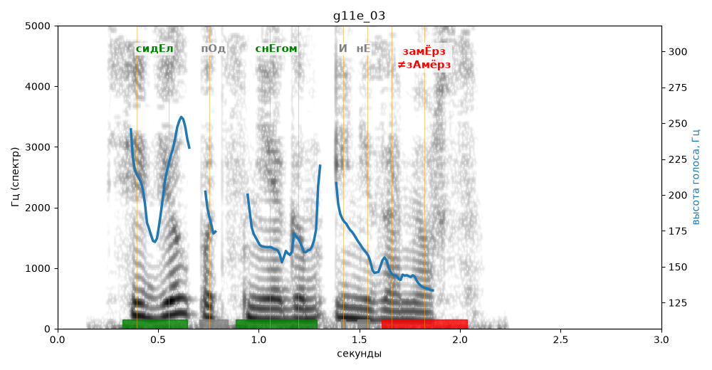

# g11e_03

Голос: **edge:ru-RU-SvetlanaNeural** · длительность 3.0 с
Естественность (UTMOS): **3.87 из 5** (живой диктор ≈ 4–4.5)
Эталон: Сидел под снегом и не замёрз!
Распознано: сидел под снегом и не замерз.
Слова: все совпали

## Ударения
(где нужно: ruaccent)

| слово | нужно | у голоса | |
|---|---|---|---|
| сидел | сидЕл | сидЕл | ✓ |
| снегом | снЕгом | снЕгом | ✓ |
| замёрз | замЁрз | зАмёрз | ✗ ОШИБКА |

## Интонация
- ✓ «сидел под снегом и не замёрз!» — выделено слово «сидел» (+5.5 пт)
- Диапазон голоса 9.7 полутонов (живо), средняя высота 167 Гц

## Паузы и темп
- паузы на своих местах
- Темп 5.3 слога/с (нормально)

_Синяя линия — высота голоса. Над словами заглавная буква — где ударение должно быть; красным — голос поставил не туда (уверенно), оранжевым — возможно._
