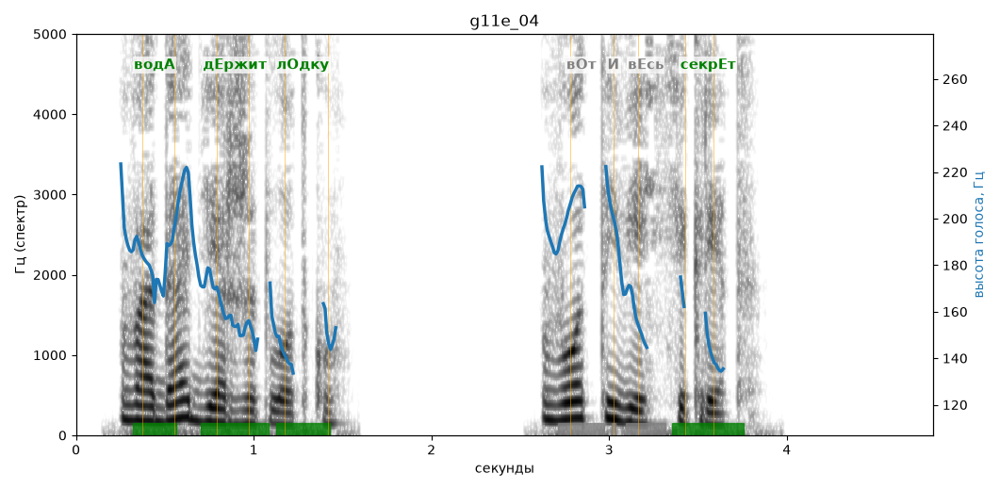

# g11e_04

Голос: **edge:ru-RU-SvetlanaNeural** · длительность 4.8 с
Естественность (UTMOS): **3.77 из 5** (живой диктор ≈ 4–4.5)
Эталон: Вода держит лодку. Вот и весь секрет!
Распознано: Вода держит лодку. Вот и весь секрет.
Слова: все совпали

## Ударения
(где нужно: ruaccent)

| слово | нужно | у голоса | |
|---|---|---|---|
| вода | водА | водА | ✓ |
| держит | дЕржит | дЕржит | ✓ |
| лодку | лОдку | лОдку | ✓ |
| секрет | секрЕт | секрЕт | ✓ |

## Интонация
- ✓ «вода держит лодку.» — конец фразы понижается — звучит законченно
- ✓ «вот и весь секрет!» — выделено слово «вот» (+3.2 пт)
- Диапазон голоса 7.6 полутонов (живо), средняя высота 172 Гц

## Паузы и темп
- паузы на своих местах
- Темп 5.1 слога/с (нормально)

_Синяя линия — высота голоса. Над словами заглавная буква — где ударение должно быть; красным — голос поставил не туда (уверенно), оранжевым — возможно._
