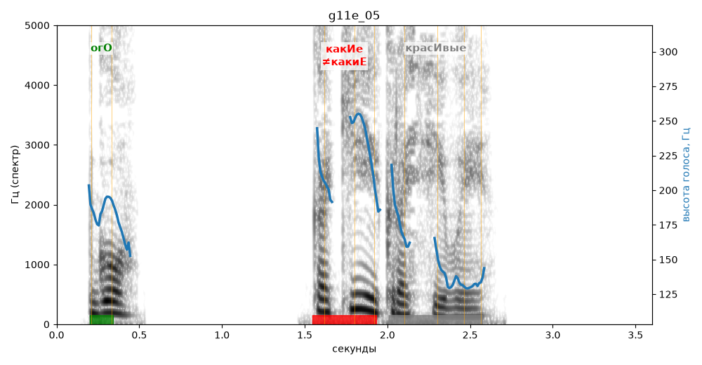

# g11e_05

Голос: **edge:ru-RU-SvetlanaNeural** · длительность 3.6 с
Естественность (UTMOS): **3.98 из 5** (живой диктор ≈ 4–4.5)
Эталон: Ого! Какие красивые!
Распознано: Го! Какие красивые!
Расхождения в словах: «ого» → «го»

## Ударения
(где нужно: ruaccent)

| слово | нужно | у голоса | |
|---|---|---|---|
| ого | огО | огО | ✓ |
| какие | какИе | какиЕ | ✗ ОШИБКА |
| красивые | красИвые | крАсивые | ? не разобрать |

## Интонация
- ✓ «какие красивые!» — выделено слово «какие» (+6.6 пт)
- Диапазон голоса 11.5 полутонов (живо), средняя высота 180 Гц

## Паузы и темп
- паузы на своих местах
- Темп 7.7 слога/с (быстро)

_Синяя линия — высота голоса. Над словами заглавная буква — где ударение должно быть; красным — голос поставил не туда (уверенно), оранжевым — возможно._
