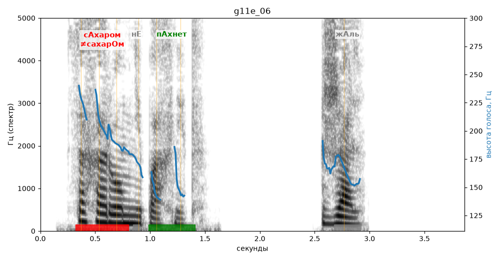

# g11e_06

Голос: **edge:ru-RU-SvetlanaNeural** · длительность 3.9 с
Естественность (UTMOS): **3.61 из 5** (живой диктор ≈ 4–4.5)
Эталон: Са́харом не пахнет. Жаль.
Распознано: Сахаром не пахнет. Жаль.
Расхождения в словах: «са харом» → «сахаром»

## Ударения
(где нужно: ruaccent)

| слово | нужно | у голоса | |
|---|---|---|---|
| сахаром | сАхаром | сахарОм | ✗ ОШИБКА |
| пахнет | пАхнет | пАхнет | ✓ |

## Интонация
- ✓ «сахаром не пахнет.» — конец фразы понижается — звучит законченно
- Диапазон голоса 7.9 полутонов (живо), средняя высота 176 Гц

## Паузы и темп
- паузы на своих местах
- Темп 5.3 слога/с (нормально)

_Синяя линия — высота голоса. Над словами заглавная буква — где ударение должно быть; красным — голос поставил не туда (уверенно), оранжевым — возможно._
