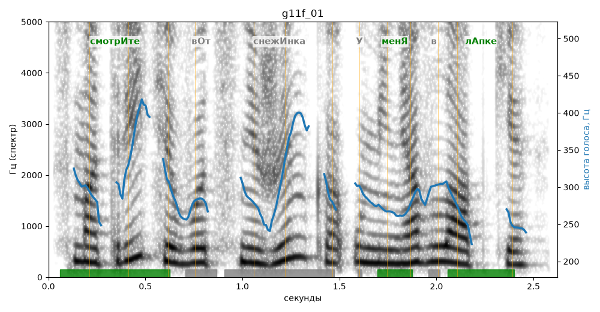

# g11f_01

Естественность (UTMOS): **3.31 из 5** (живой диктор ≈ 4–4.5)
Эталон: Смотрите! Вот снежинка! У меня в лапке!
Распознано: Смотрите, вот снежинка у меня в лапке.
Слова: все совпали

## Ударения
(где нужно: ruaccent)

| слово | нужно | у голоса | |
|---|---|---|---|
| смотрите | смотрИте | смотрИте | ✓ |
| снежинка | снежИнка | снЕжинка | ? не разобрать |
| меня | менЯ | менЯ | ✓ |
| лапке | лАпке | лАпке | ✓ |

## Интонация
- ✓ «смотрите!» — выделено слово «смотрите» (+3.0 пт)
- ✓ «вот снежинка!» — выделено слово «снежинка» (+4.4 пт)
- ✗ «у меня в лапке!» — восклицание звучит ровно, без эмоции
- Диапазон голоса 8.3 полутонов (живо), средняя высота 284 Гц

## Паузы и темп
- после «смотрите!» пауза всего 0.08 с — фразы слипаются
- после «снежинка!» пауза всего 0.12 с — фразы слипаются
- Темп 5.6 слога/с (нормально)

_Синяя линия — высота голоса. Над словами заглавная буква — где ударение должно быть; красным — голос поставил не туда (уверенно), оранжевым — возможно._
