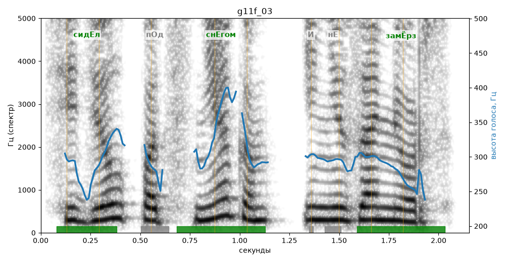

# g11f_03

Естественность (UTMOS): **3.09 из 5** (живой диктор ≈ 4–4.5)
Эталон: Сидел под снегом и не замёрз!
Распознано: сидел под снегом и не замерз.
Слова: все совпали

## Ударения
(где нужно: ruaccent)

| слово | нужно | у голоса | |
|---|---|---|---|
| сидел | сидЕл | сидЕл | ✓ |
| снегом | снЕгом | снЕгом | ✓ |
| замёрз | замЁрз | замЁрз | ✓ |

## Интонация
- ✗ «сидел под снегом и не замёрз!» — восклицание звучит ровно, без эмоции
- Диапазон голоса 7.1 полутонов (живо), средняя высота 295 Гц

## Паузы и темп
- паузы на своих местах
- Темп 5.2 слога/с (нормально)

_Синяя линия — высота голоса. Над словами заглавная буква — где ударение должно быть; красным — голос поставил не туда (уверенно), оранжевым — возможно._
