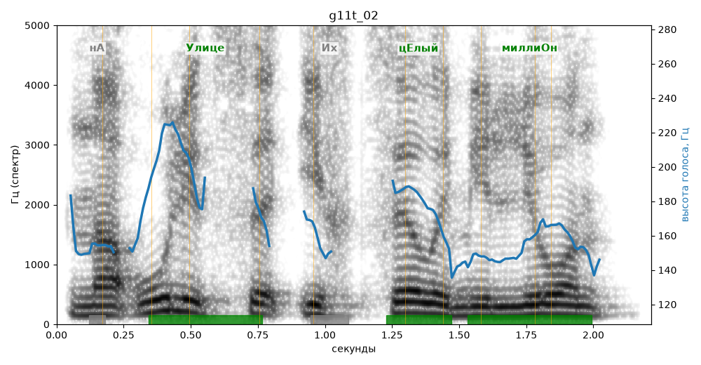

# g11t_02

Естественность (UTMOS): **3.09 из 5** (живой диктор ≈ 4–4.5)
Эталон: На улице их целый миллион!
Распознано: на улице их целый миллион.
Слова: все совпали

## Ударения
(где нужно: ruaccent)

| слово | нужно | у голоса | |
|---|---|---|---|
| улице | Улице | Улице | ✓ |
| целый | цЕлый | цЕлый | ✓ |
| миллион | миллиОн | миллиОн | ✓ |

## Интонация
- ✓ «на улице их целый миллион!» — выделено слово «улице» (+2.7 пт)
- Диапазон голоса 7.0 полутонов (живо), средняя высота 160 Гц

## Паузы и темп
- паузы на своих местах
- Темп 6.5 слога/с (нормально)

_Синяя линия — высота голоса. Над словами заглавная буква — где ударение должно быть; красным — голос поставил не туда (уверенно), оранжевым — возможно._
