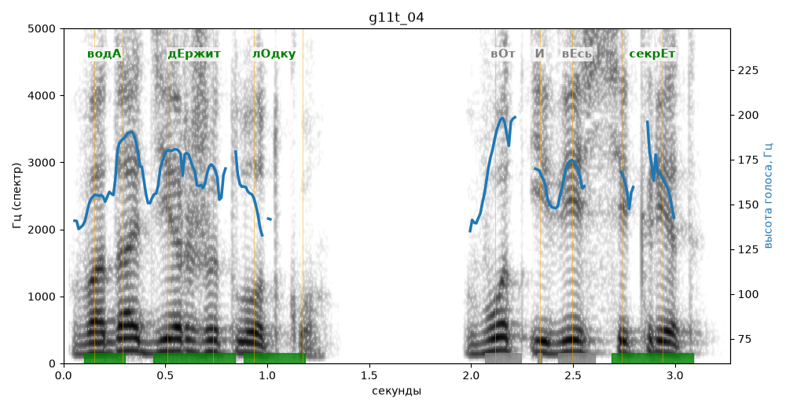

# g11t_04

Естественность (UTMOS): **3.32 из 5** (живой диктор ≈ 4–4.5)
Эталон: Вода держит лодку. Вот и весь секрет!
Распознано: Вода держит лодку. Вот и весь секрет.
Слова: все совпали

## Ударения
(где нужно: ruaccent)

| слово | нужно | у голоса | |
|---|---|---|---|
| вода | водА | водА | ✓ |
| держит | дЕржит | дЕржит | ✓ |
| лодку | лОдку | лОдку | ✓ |
| секрет | секрЕт | секрЕт | ✓ |

## Интонация
- ✓ «вода держит лодку.» — конец фразы понижается — звучит законченно
- ✗ «вот и весь секрет!» — восклицание звучит ровно, без эмоции
- Диапазон голоса 5.5 полутонов (нормально), средняя высота 163 Гц

## Паузы и темп
- паузы на своих местах
- Темп 5.2 слога/с (нормально)

_Синяя линия — высота голоса. Над словами заглавная буква — где ударение должно быть; красным — голос поставил не туда (уверенно), оранжевым — возможно._
