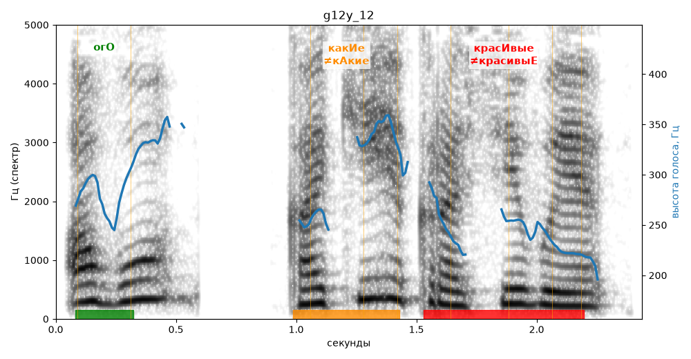

# g12y_12

Естественность (UTMOS): **3.71 из 5** (живой диктор ≈ 4–4.5)
Эталон: Ого! Какие красивые!
Распознано: А вот, какие красивые!
Расхождения в словах: «ого» → «а вот»

## Ударения
(где нужно: ruaccent)

| слово | нужно | у голоса | |
|---|---|---|---|
| ого | огО | огО | ✓ |
| какие | какИе | кАкие | ✗? возможно — послушать |
| красивые | красИвые | красивыЕ | ✗ ОШИБКА |

## Интонация
- ✓ «какие красивые!» — выделено слово «какие» (+4.8 пт)
- Диапазон голоса 8.1 полутонов (живо), средняя высота 261 Гц

## Паузы и темп
- паузы на своих местах
- Темп 6.2 слога/с (нормально)

_Синяя линия — высота голоса. Над словами заглавная буква — где ударение должно быть; красным — голос поставил не туда (уверенно), оранжевым — возможно._
