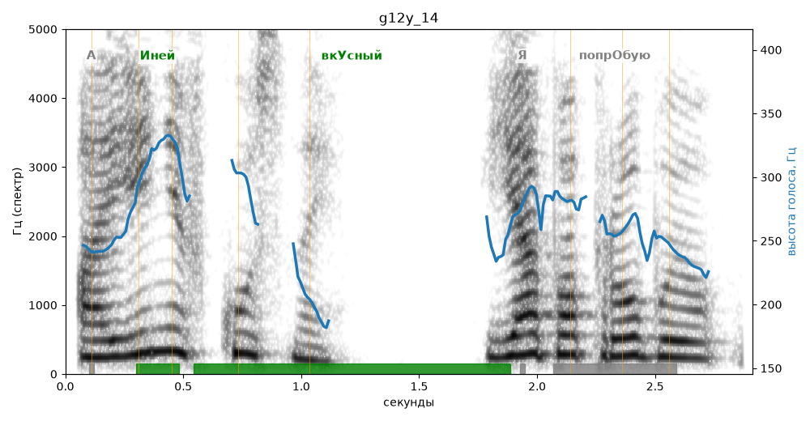

# g12y_14

Естественность (UTMOS): **3.64 из 5** (живой диктор ≈ 4–4.5)
Эталон: А иней вкусный? Я попробую!
Распознано: А и не вкусный. Я попробую.
Расхождения в словах: «иней» → «и не»

## Ударения
(где нужно: ruaccent)

| слово | нужно | у голоса | |
|---|---|---|---|
| иней | Иней | Иней | ✓ |
| вкусный | вкУсный | вкУсный | ✓ |
| попробую | попрОбую | — | ? |

## Интонация
- ✗ «а иней вкусный?» — нет вопросительного подъёма (самое высокое место — «вкусный», в начале) — звучит как утверждение
- ✗ «я попробую!» — восклицание звучит ровно, без эмоции
- Диапазон голоса 7.9 полутонов (живо), средняя высота 259 Гц

## Паузы и темп
- после «вкусный?» пауза всего 0.04 с — фразы слипаются
- Темп 3.5 слога/с (медленно)

_Синяя линия — высота голоса. Над словами заглавная буква — где ударение должно быть; красным — голос поставил не туда (уверенно), оранжевым — возможно._
