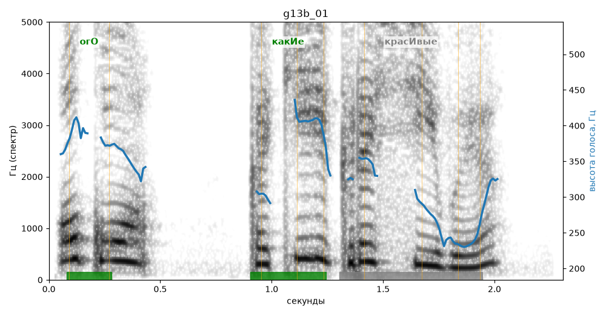

# g13b_01

Естественность (UTMOS): **2.45 из 5** (живой диктор ≈ 4–4.5)
Эталон: Ого! Какие красивые!
Распознано: Ого, какие красивые!
Слова: все совпали

## Ударения
(где нужно: ruaccent)

| слово | нужно | у голоса | |
|---|---|---|---|
| ого | огО | огО | ✓ |
| какие | какИе | какИе | ✓ |
| красивые | красИвые | красивыЕ | ? не разобрать |

## Интонация
- ✓ «какие красивые!» — выделено слово «какие» (+5.0 пт)
- Диапазон голоса 9.7 полутонов (живо), средняя высота 337 Гц

## Паузы и темп
- паузы на своих местах
- Темп 7.2 слога/с (быстро)

_Синяя линия — высота голоса. Над словами заглавная буква — где ударение должно быть; красным — голос поставил не туда (уверенно), оранжевым — возможно._
