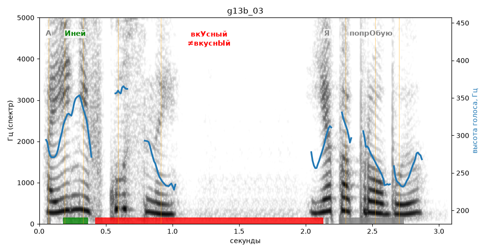

# g13b_03

Естественность (UTMOS): **3.13 из 5** (живой диктор ≈ 4–4.5)
Эталон: А иней вкусный? Я попробую!
Распознано: А ей не вкусный? Я попробую.
Расхождения в словах: «иней» → «ей не»

## Ударения
(где нужно: ruaccent)

| слово | нужно | у голоса | |
|---|---|---|---|
| иней | Иней | Иней | ✓ |
| вкусный | вкУсный | вкуснЫй | ✗ ОШИБКА |
| попробую | попрОбую | — | ? |

## Интонация
- ✓ «а иней вкусный?» — вопросительный подъём на слове «вкусный»
- ✗ «я попробую!» — восклицание звучит ровно, без эмоции
- Диапазон голоса 7.4 полутонов (живо), средняя высота 277 Гц

## Паузы и темп
- после «вкусный?» пауза всего 0.02 с — фразы слипаются
- Темп 3.0 слога/с (медленно)

_Синяя линия — высота голоса. Над словами заглавная буква — где ударение должно быть; красным — голос поставил не туда (уверенно), оранжевым — возможно._
