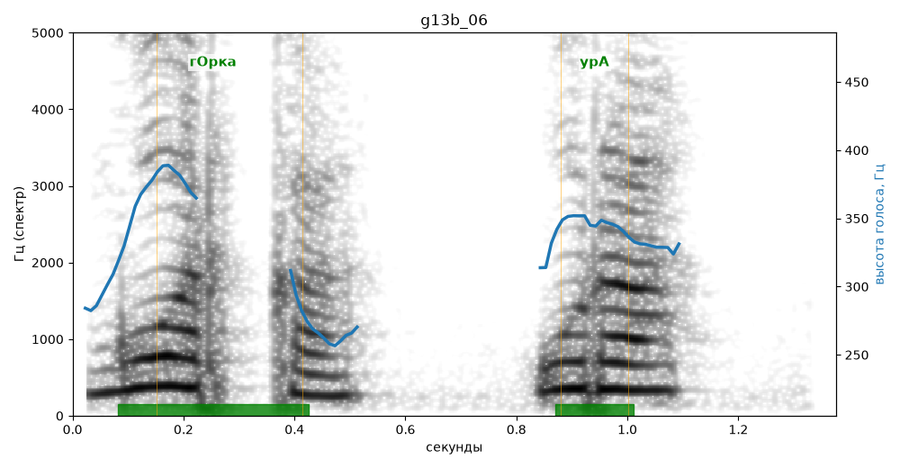

# g13b_06

Естественность (UTMOS): **2.25 из 5** (живой диктор ≈ 4–4.5)
Эталон: Горка! Ура!
Распознано: Горка! Ура!
Слова: все совпали

## Ударения
(где нужно: ruaccent)

| слово | нужно | у голоса | |
|---|---|---|---|
| горка | гОрка | гОрка | ✓ |
| ура | урА | урА | ✓ |

## Интонация
- Диапазон голоса 6.6 полутонов (нормально), средняя высота 331 Гц

## Паузы и темп
- паузы на своих местах
- Темп 8.2 слога/с (быстро)

_Синяя линия — высота голоса. Над словами заглавная буква — где ударение должно быть; красным — голос поставил не туда (уверенно), оранжевым — возможно._
