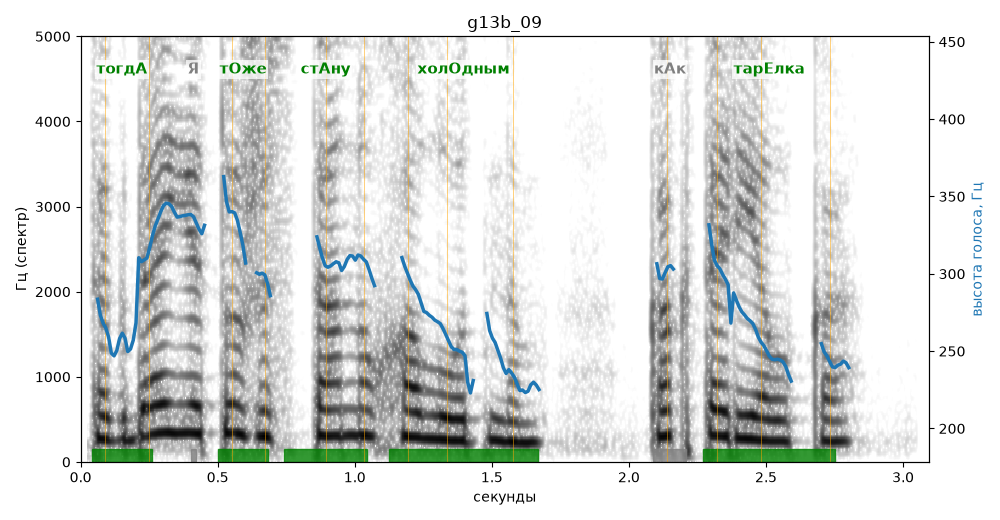

# g13b_09

Естественность (UTMOS): **2.39 из 5** (живой диктор ≈ 4–4.5)
Эталон: Тогда я тоже стану холодным. Как тарелка!
Распознано: Тогда я тоже стану холодным, как тарелка.
Слова: все совпали

## Ударения
(где нужно: ruaccent)

| слово | нужно | у голоса | |
|---|---|---|---|
| тогда | тогдА | тогдА | ✓ |
| тоже | тОже | тОже | ✓ |
| стану | стАну | стАну | ✓ |
| холодным | холОдным | холОдным | ✓ |
| тарелка | тарЕлка | тарЕлка | ✓ |

## Интонация
- ✓ «тогда я тоже стану холодным.» — конец фразы понижается — звучит законченно
- ✗ «как тарелка!» — восклицание звучит ровно, без эмоции
- Диапазон голоса 6.8 полутонов (нормально), средняя высота 283 Гц

## Паузы и темп
- паузы на своих местах
- Темп 5.7 слога/с (нормально)

_Синяя линия — высота голоса. Над словами заглавная буква — где ударение должно быть; красным — голос поставил не туда (уверенно), оранжевым — возможно._
