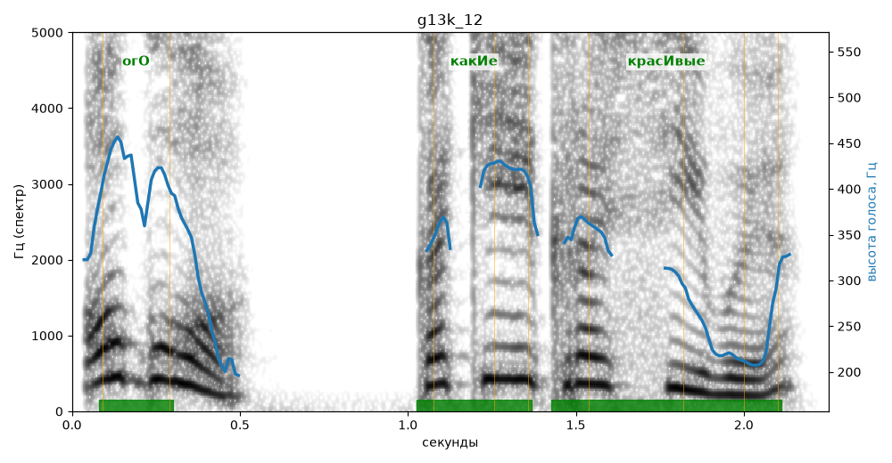

# g13k_12

Естественность (UTMOS): **2.86 из 5** (живой диктор ≈ 4–4.5)
Эталон: Ого! Какие красивые!
Распознано: Ого! Какие красивые!
Слова: все совпали

## Ударения
(где нужно: ruaccent)

| слово | нужно | у голоса | |
|---|---|---|---|
| ого | огО | огО | ✓ |
| какие | какИе | какИе | ✓ |
| красивые | красИвые | красИвые | ✓ |

## Интонация
- ✓ «какие красивые!» — выделено слово «какие» (+3.4 пт)
- Диапазон голоса 12.7 полутонов (живо), средняя высота 346 Гц

## Паузы и темп
- паузы на своих местах
- Темп 6.9 слога/с (быстро)

_Синяя линия — высота голоса. Над словами заглавная буква — где ударение должно быть; красным — голос поставил не туда (уверенно), оранжевым — возможно._
