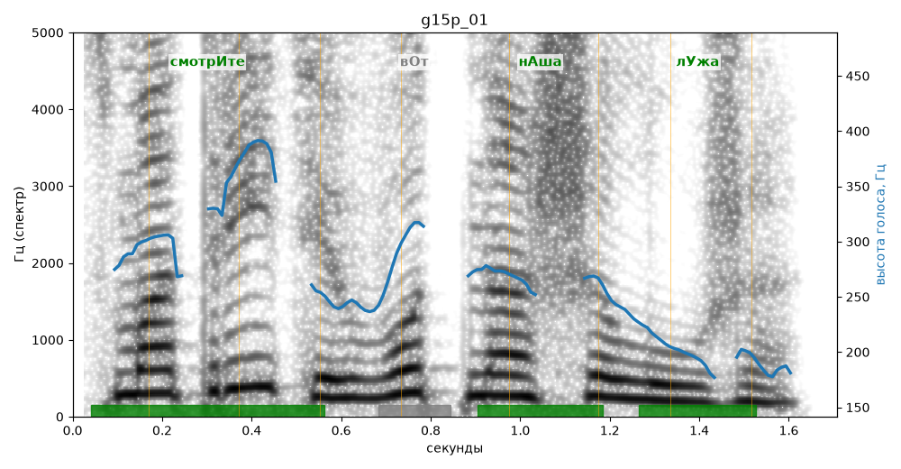

# g15p_01

Естественность (UTMOS): **3.74 из 5** (живой диктор ≈ 4–4.5)
Эталон: Смотрите, вот наша лужа.
Распознано: Смотрите вот наше лужа.
Расхождения в словах: «наша» → «наше»

## Ударения
(где нужно: ruaccent)

| слово | нужно | у голоса | |
|---|---|---|---|
| смотрите | смотрИте | смотрИте | ✓ |
| наша | нАша | нАша | ✓ |
| лужа | лУжа | лУжа | ✓ |

## Интонация
- ✓ «смотрите вот наша лужа.» — конец фразы понижается — звучит законченно
- Диапазон голоса 12.6 полутонов (живо), средняя высота 261 Гц

## Паузы и темп
- паузы на своих местах
- Темп 5.4 слога/с (нормально)

_Синяя линия — высота голоса. Над словами заглавная буква — где ударение должно быть; красным — голос поставил не туда (уверенно), оранжевым — возможно._
