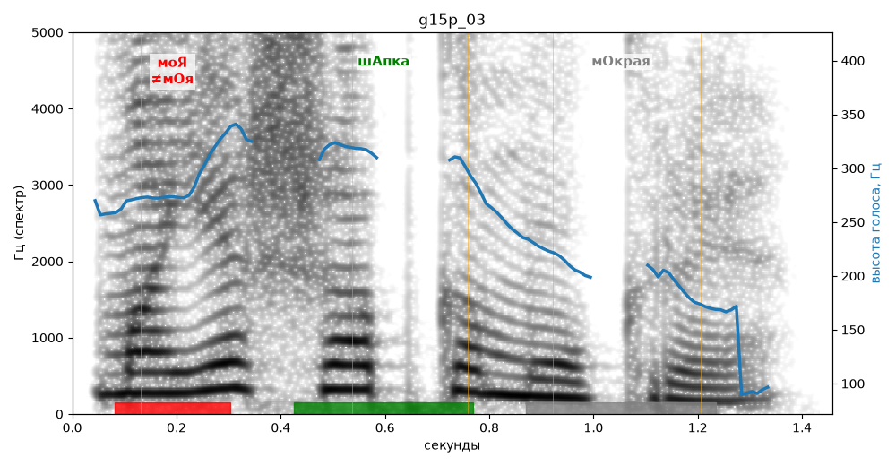

# g15p_03

Естественность (UTMOS): **4.17 из 5** (живой диктор ≈ 4–4.5)
Эталон: Моя шапка мокрая.
Распознано: Моя шапка мокрая.
Слова: все совпали

## Ударения
(где нужно: ruaccent)

| слово | нужно | у голоса | |
|---|---|---|---|
| моя | моЯ | мОя | ✗ ОШИБКА |
| шапка | шАпка | шАпка | ✓ |
| мокрая | мОкрая | — | ? |

## Интонация
- ✓ «моя шапка мокрая.» — конец фразы понижается — звучит законченно
- Диапазон голоса 21.2 полутонов (живо), средняя высота 262 Гц

## Паузы и темп
- паузы на своих местах
- Темп 4.3 слога/с (нормально)

_Синяя линия — высота голоса. Над словами заглавная буква — где ударение должно быть; красным — голос поставил не туда (уверенно), оранжевым — возможно._
