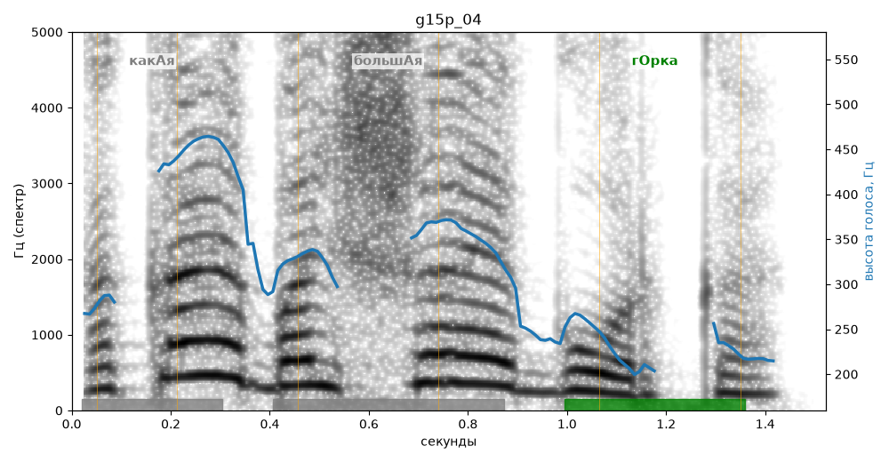

# g15p_04

Естественность (UTMOS): **2.01 из 5** (живой диктор ≈ 4–4.5)
Эталон: Какая большая горка!
Распознано: Какая большая горка!
Слова: все совпали

## Ударения
(где нужно: ruaccent)

| слово | нужно | у голоса | |
|---|---|---|---|
| какая | какАя | — | ? |
| большая | большАя | — | ? |
| горка | гОрка | гОрка | ✓ |

## Интонация
- ✓ «какая большая горка!» — выделено слово «какая» (+6.9 пт)
- Диапазон голоса 13.4 полутонов (живо), средняя высота 308 Гц

## Паузы и темп
- паузы на своих местах
- Темп 4.5 слога/с (нормально)

_Синяя линия — высота голоса. Над словами заглавная буква — где ударение должно быть; красным — голос поставил не туда (уверенно), оранжевым — возможно._
