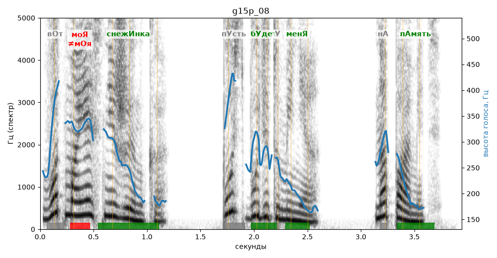

# g15p_08

Естественность (UTMOS): **3.58 из 5** (живой диктор ≈ 4–4.5)
Эталон: Вот моя снежинка. Пусть будет у меня. На память.
Распознано: Вот моя снежинка. Пусть будет у меня. На память.
Слова: все совпали

## Ударения
(где нужно: ruaccent)

| слово | нужно | у голоса | |
|---|---|---|---|
| моя | моЯ | мОя | ✗ ОШИБКА |
| снежинка | снежИнка | снежИнка | ✓ |
| будет | бУдет | бУдет | ✓ |
| меня | менЯ | менЯ | ✓ |
| память | пАмять | пАмять | ✓ |

## Интонация
- ✓ «вот моя снежинка.» — конец фразы понижается — звучит законченно
- ✓ «пусть будет у меня.» — конец фразы понижается — звучит законченно
- ✗ «на память.» — конец фразы не понижается — звучит незаконченно / как перечисление
- Диапазон голоса 14.1 полутонов (живо), средняя высота 255 Гц

## Паузы и темп
- паузы на своих местах
- Темп 5.9 слога/с (нормально)

_Синяя линия — высота голоса. Над словами заглавная буква — где ударение должно быть; красным — голос поставил не туда (уверенно), оранжевым — возможно._
