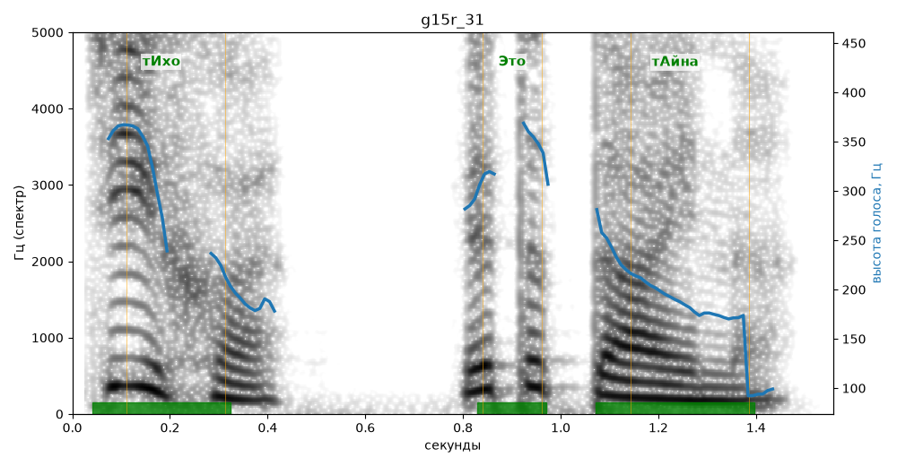

# g15r_31

Естественность (UTMOS): **3.72 из 5** (живой диктор ≈ 4–4.5)
Эталон: Тихо! Это тайна.
Распознано: Тихо, это тайна.
Слова: все совпали

## Ударения
(где нужно: ruaccent)

| слово | нужно | у голоса | |
|---|---|---|---|
| тихо | тИхо | тИхо | ✓ |
| это | Это | Это | ✓ |
| тайна | тАйна | тАйна | ✓ |

## Интонация
- ✓ «это тайна.» — конец фразы понижается — звучит законченно
- Диапазон голоса 23.0 полутонов (живо), средняя высота 212 Гц

## Паузы и темп
- паузы на своих местах
- Темп 7.1 слога/с (быстро)

_Синяя линия — высота голоса. Над словами заглавная буква — где ударение должно быть; красным — голос поставил не туда (уверенно), оранжевым — возможно._
