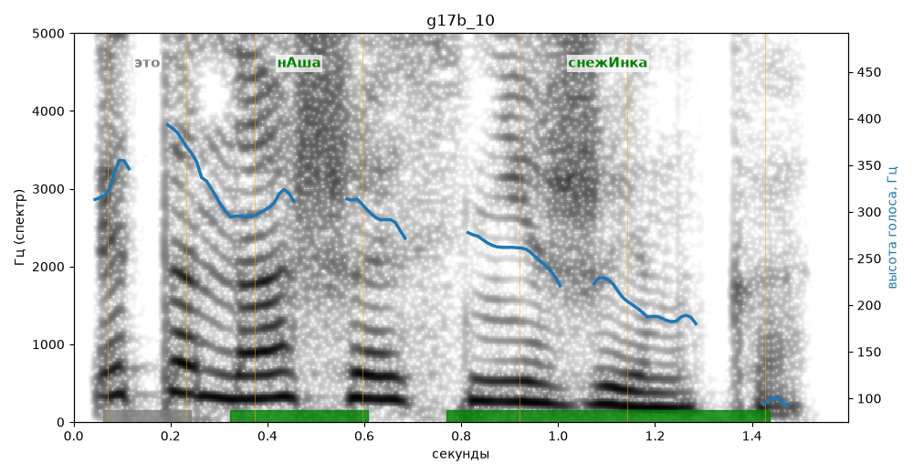

# g17b_10

Естественность (UTMOS): **3.58 из 5** (живой диктор ≈ 4–4.5)
Эталон: Это наша снежинка.
Распознано: Это наша снежинка.
Слова: все совпали

## Ударения
(где нужно: ruaccent)

| слово | нужно | у голоса | |
|---|---|---|---|
| это | это | Это | нет эталона |
| наша | нАша | нАша | ✓ |
| снежинка | снежИнка | снежИнка | ✓ |

## Интонация
- ✓ «это наша снежинка.» — конец фразы понижается — звучит законченно
- Диапазон голоса 22.2 полутонов (живо), средняя высота 276 Гц

## Паузы и темп
- паузы на своих местах
- Темп 5.8 слога/с (нормально)

_Синяя линия — высота голоса. Над словами заглавная буква — где ударение должно быть; красным — голос поставил не туда (уверенно), оранжевым — возможно._
