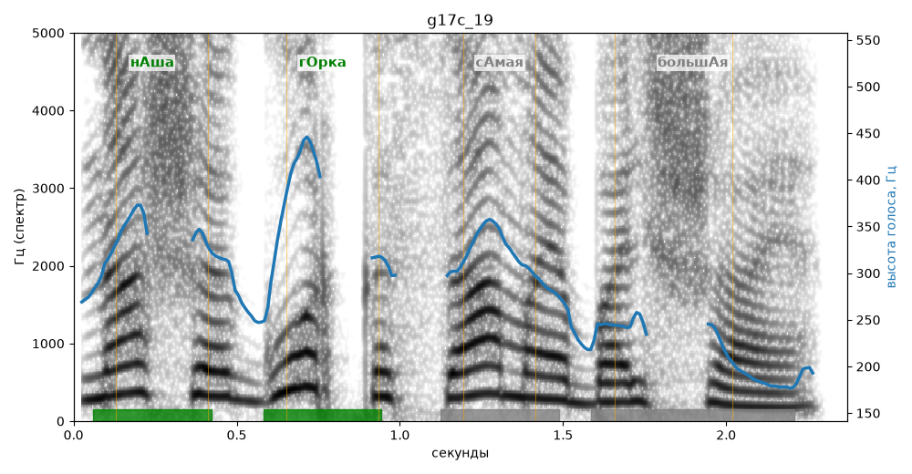

# g17c_19

Естественность (UTMOS): **3.66 из 5** (живой диктор ≈ 4–4.5)
Эталон: Наша горка самая большая!
Распознано: Наша горка самая большая.
Слова: все совпали

## Ударения
(где нужно: ruaccent)

| слово | нужно | у голоса | |
|---|---|---|---|
| наша | нАша | нАша | ✓ |
| горка | гОрка | гОрка | ✓ |
| самая | сАмая | — | ? |
| большая | большАя | — | ? |

## Интонация
- ✓ «наша горка самая большая!» — выделено слово «горка» (+2.9 пт)
- Диапазон голоса 14.0 полутонов (живо), средняя высота 290 Гц

## Паузы и темп
- паузы на своих местах
- Темп 4.4 слога/с (нормально)

_Синяя линия — высота голоса. Над словами заглавная буква — где ударение должно быть; красным — голос поставил не туда (уверенно), оранжевым — возможно._
