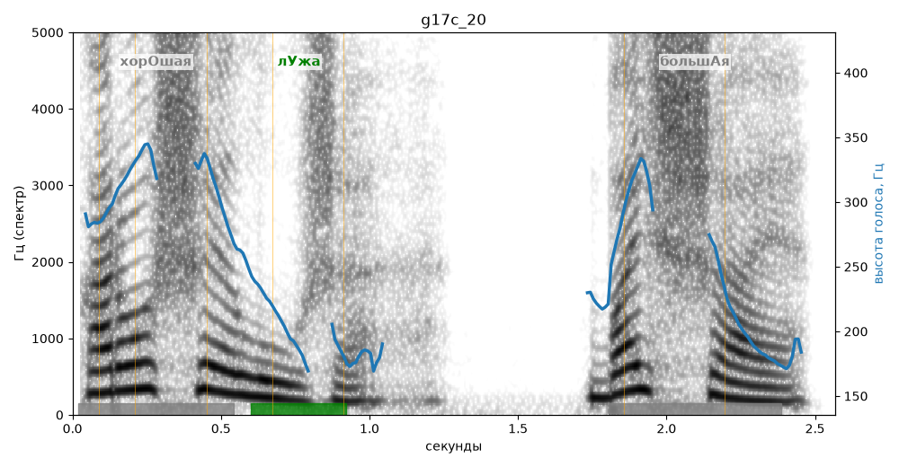

# g17c_20

Естественность (UTMOS): **3.73 из 5** (живой диктор ≈ 4–4.5)
Эталон: Хорошая лужа. Большая!
Распознано: Хорошая лужа. Большая.
Слова: все совпали

## Ударения
(где нужно: ruaccent)

| слово | нужно | у голоса | |
|---|---|---|---|
| хорошая | хорОшая | — | ? |
| лужа | лУжа | лУжа | ✓ |
| большая | большАя | — | ? |

## Интонация
- ✓ «хорошая лужа.» — конец фразы понижается — звучит законченно
- Диапазон голоса 11.2 полутонов (живо), средняя высота 233 Гц

## Паузы и темп
- паузы на своих местах
- Темп 4.7 слога/с (нормально)

_Синяя линия — высота голоса. Над словами заглавная буква — где ударение должно быть; красным — голос поставил не туда (уверенно), оранжевым — возможно._
