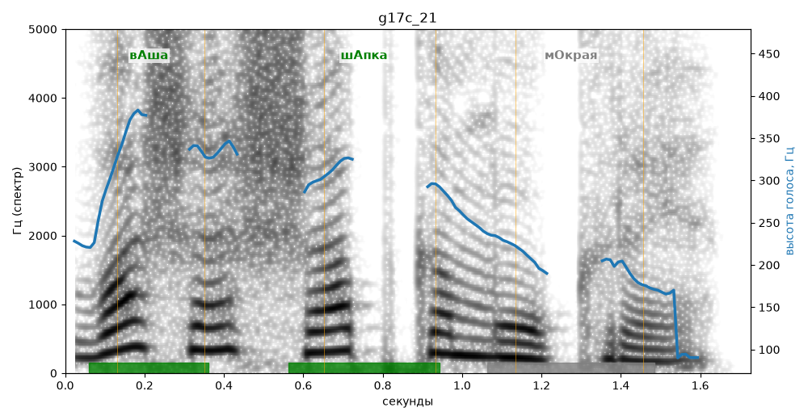

# g17c_21

Естественность (UTMOS): **3.96 из 5** (живой диктор ≈ 4–4.5)
Эталон: Ваша шапка мокрая.
Распознано: Ваша шапка мокрая.
Слова: все совпали

## Ударения
(где нужно: ruaccent)

| слово | нужно | у голоса | |
|---|---|---|---|
| ваша | вАша | вАша | ✓ |
| шапка | шАпка | шАпка | ✓ |
| мокрая | мОкрая | — | ? |

## Интонация
- ✓ «ваша шапка мокрая.» — конец фразы понижается — звучит законченно
- Диапазон голоса 23.1 полутонов (живо), средняя высота 251 Гц

## Паузы и темп
- паузы на своих местах
- Темп 4.9 слога/с (нормально)

_Синяя линия — высота голоса. Над словами заглавная буква — где ударение должно быть; красным — голос поставил не туда (уверенно), оранжевым — возможно._
