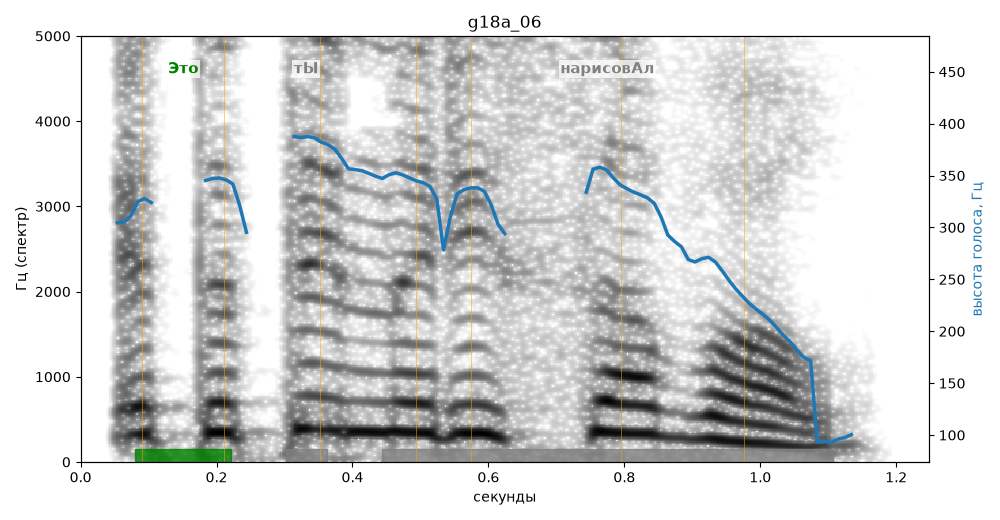

# g18a_06

Естественность (UTMOS): **2.86 из 5** (живой диктор ≈ 4–4.5)
Эталон: Это ты нарисовал?
Распознано: Это ты нарисовал!
Слова: все совпали

## Ударения
(где нужно: ruaccent)

| слово | нужно | у голоса | |
|---|---|---|---|
| это | Это | Это | ✓ |
| нарисовал | нарисовАл | нарИсовал | ? не разобрать |

## Интонация
- ✗ «это ты нарисовал?» — нет вопросительного подъёма (самое высокое место — «ты», в начале) — звучит как утверждение
- Диапазон голоса 23.5 полутонов (живо), средняя высота 327 Гц

## Паузы и темп
- паузы на своих местах
- Темп 6.8 слога/с (быстро)

_Синяя линия — высота голоса. Над словами заглавная буква — где ударение должно быть; красным — голос поставил не туда (уверенно), оранжевым — возможно._
