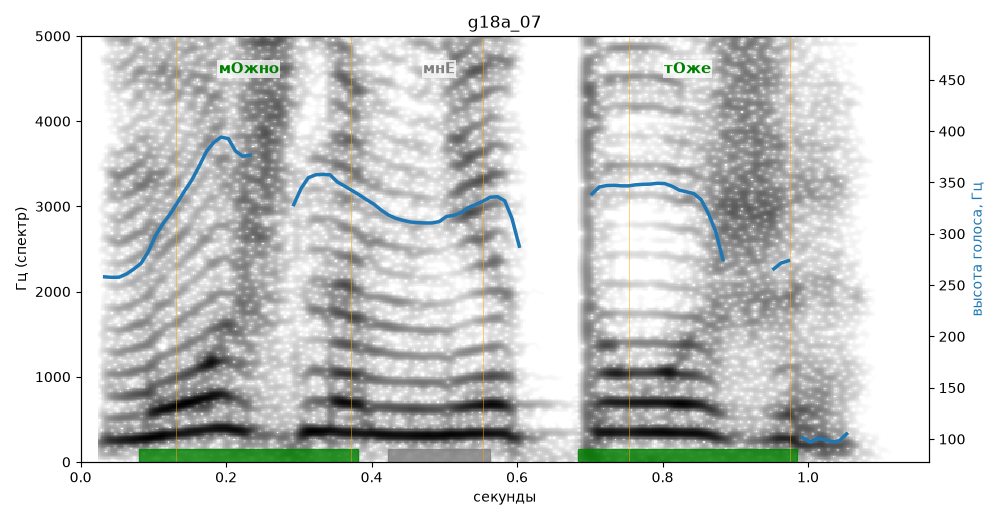

# g18a_07

Естественность (UTMOS): **2.79 из 5** (живой диктор ≈ 4–4.5)
Эталон: Можно мне тоже?
Распознано: Можно мне тоже.
Слова: все совпали

## Ударения
(где нужно: ruaccent)

| слово | нужно | у голоса | |
|---|---|---|---|
| можно | мОжно | мОжно | ✓ |
| тоже | тОже | тОже | ✓ |

## Интонация
- ✗ «можно мне тоже?» — нет вопросительного подъёма (самое высокое место — «тоже», в начале) — звучит как утверждение
- Диапазон голоса 23.0 полутонов (живо), средняя высота 330 Гц

## Паузы и темп
- паузы на своих местах
- Темп 5.5 слога/с (нормально)

_Синяя линия — высота голоса. Над словами заглавная буква — где ударение должно быть; красным — голос поставил не туда (уверенно), оранжевым — возможно._
