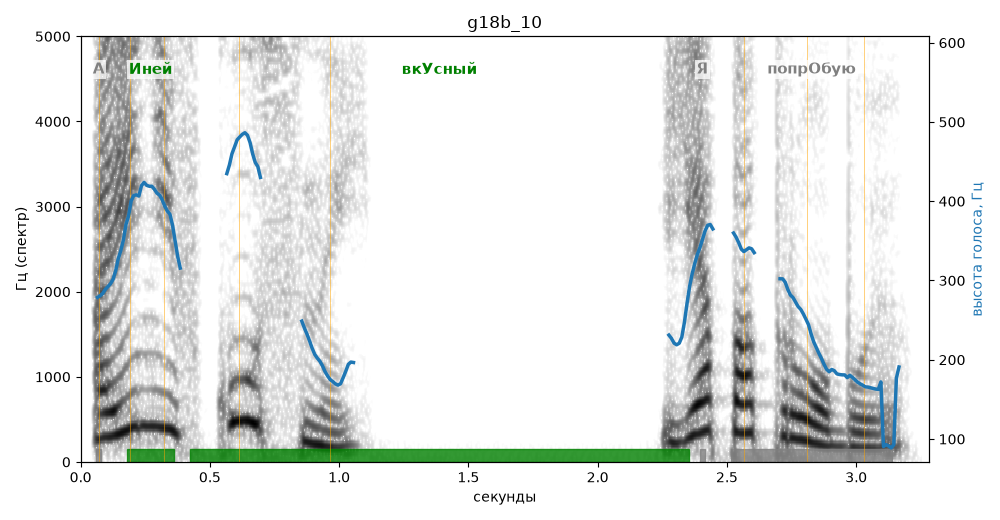

# g18b_10

Естественность (UTMOS): **3.43 из 5** (живой диктор ≈ 4–4.5)
Эталон: А иней вкусный? Я попробую!
Распознано: А и невкусный! Я попробую!
Расхождения в словах: «иней вкусный» → «и невкусный»

## Ударения
(где нужно: ruaccent)

| слово | нужно | у голоса | |
|---|---|---|---|
| иней | Иней | Иней | ✓ |
| вкусный | вкУсный | вкУсный | ✓ |
| попробую | попрОбую | — | ? |

## Интонация
- ✓ «а иней вкусный?» — вопросительный подъём на слове «вкусный»
- ✗ «я попробую!» — восклицание звучит ровно, без эмоции
- Диапазон голоса 17.9 полутонов (живо), средняя высота 279 Гц

## Паузы и темп
- после «вкусный?» пауза всего 0.04 с — фразы слипаются
- Темп 2.6 слога/с (медленно)

_Синяя линия — высота голоса. Над словами заглавная буква — где ударение должно быть; красным — голос поставил не туда (уверенно), оранжевым — возможно._
