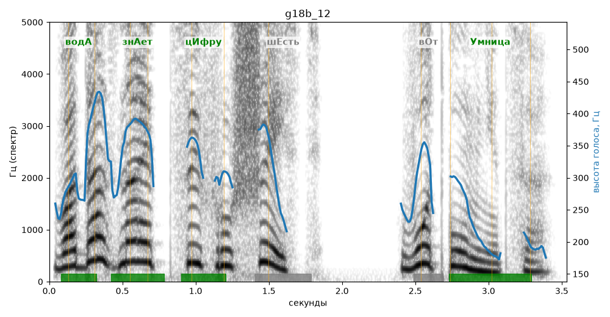

# g18b_12

Естественность (UTMOS): **2.94 из 5** (живой диктор ≈ 4–4.5)
Эталон: Вода знает цифру шесть? Вот умница!
Распознано: Вода знает цифру 6. Вот умница.
Расхождения в словах: «шесть» → «6»

## Ударения
(где нужно: ruaccent)

| слово | нужно | у голоса | |
|---|---|---|---|
| вода | водА | водА | ✓ |
| знает | знАет | знАет | ✓ |
| цифру | цИфру | цИфру | ✓ |
| умница | Умница | Умница | ✓ |

## Интонация
- ✗ «вода знает цифру шесть?» — нет вопросительного подъёма (самое высокое место — «вода», в начале) — звучит как утверждение
- ✓ «вот умница!» — выделено слово «умница» (+3.8 пт)
- Диапазон голоса 13.1 полутонов (живо), средняя высота 295 Гц

## Паузы и темп
- паузы на своих местах
- Темп 4.8 слога/с (нормально)

_Синяя линия — высота голоса. Над словами заглавная буква — где ударение должно быть; красным — голос поставил не туда (уверенно), оранжевым — возможно._
