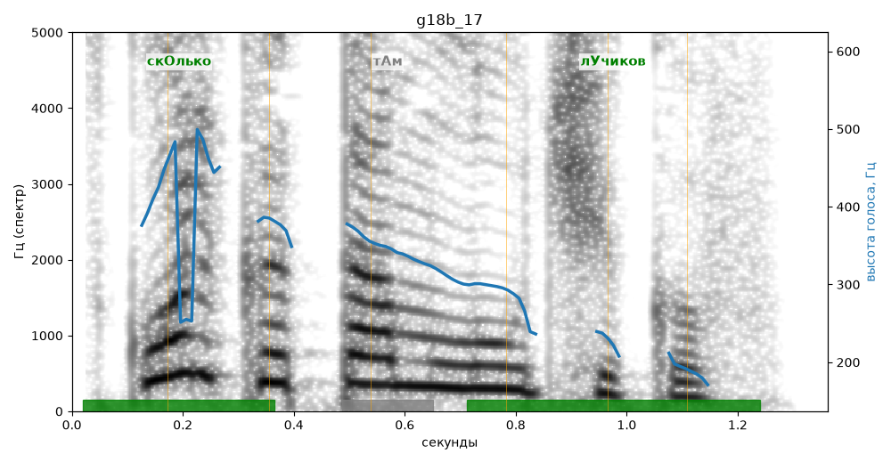

# g18b_17

Естественность (UTMOS): **3.24 из 5** (живой диктор ≈ 4–4.5)
Эталон: Сколько там лучиков?
Распознано: Сколько там лучиков?
Слова: все совпали

## Ударения
(где нужно: ruaccent)

| слово | нужно | у голоса | |
|---|---|---|---|
| сколько | скОлько | скОлько | ✓ |
| лучиков | лУчиков | лУчиков | ✓ |

## Интонация
- ✓ «сколько там лучиков?» — конец фразы понижается — звучит законченно
- Диапазон голоса 15.5 полутонов (живо), средняя высота 322 Гц

## Паузы и темп
- паузы на своих местах
- Темп 4.9 слога/с (нормально)

_Синяя линия — высота голоса. Над словами заглавная буква — где ударение должно быть; красным — голос поставил не туда (уверенно), оранжевым — возможно._
