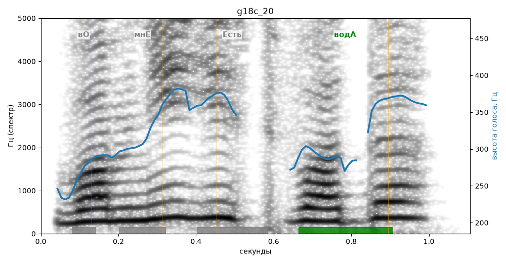

# g18c_20

Естественность (UTMOS): **3.35 из 5** (живой диктор ≈ 4–4.5)
Эталон: Во мне есть вода?
Распознано: Во мне есть вата?
Расхождения в словах: «вода» → «вата»

## Ударения
(где нужно: ruaccent)

| слово | нужно | у голоса | |
|---|---|---|---|
| вода | водА | водА | ✓ |

## Интонация
- ✗ «во мне есть вода?» — нет вопросительного подъёма (самое высокое место — «вода», в начале) — звучит как утверждение
- Диапазон голоса 7.4 полутонов (живо), средняя высота 307 Гц

## Паузы и темп
- паузы на своих местах
- Темп 6.1 слога/с (нормально)

_Синяя линия — высота голоса. Над словами заглавная буква — где ударение должно быть; красным — голос поставил не туда (уверенно), оранжевым — возможно._
