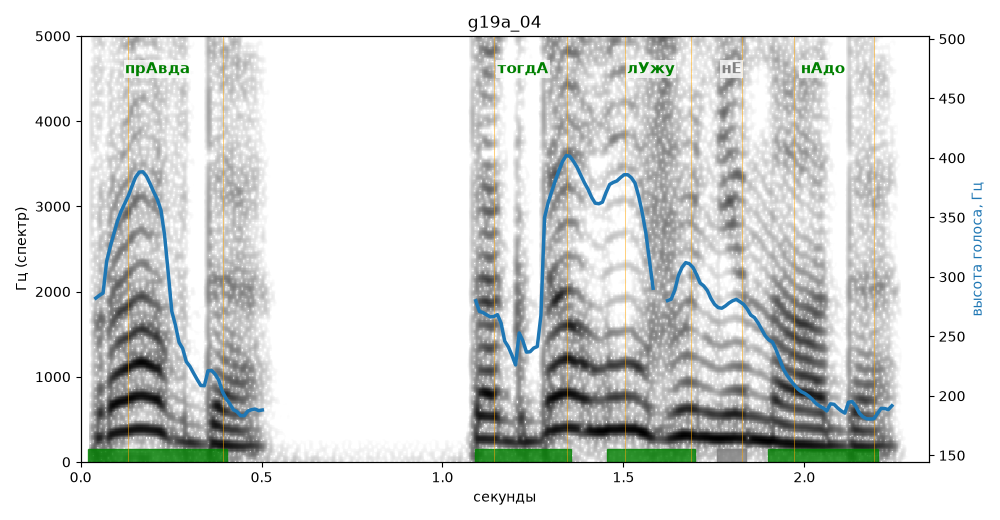

# g19a_04

Естественность (UTMOS): **2.99 из 5** (живой диктор ≈ 4–4.5)
Эталон: Правда? Тогда лужу не надо!
Распознано: Правда? Тогда лужу не надо.
Слова: все совпали

## Ударения
(где нужно: ruaccent)

| слово | нужно | у голоса | |
|---|---|---|---|
| правда | прАвда | прАвда | ✓ |
| тогда | тогдА | тогдА | ✓ |
| лужу | лУжу | лУжу | ✓ |
| надо | нАдо | нАдо | ✓ |

## Интонация
- ✓ «тогда лужу не надо!» — выделено слово «тогда» (+5.5 пт)
- Диапазон голоса 12.7 полутонов (живо), средняя высота 268 Гц

## Паузы и темп
- паузы на своих местах
- Темп 6.0 слога/с (нормально)

_Синяя линия — высота голоса. Над словами заглавная буква — где ударение должно быть; красным — голос поставил не туда (уверенно), оранжевым — возможно._
