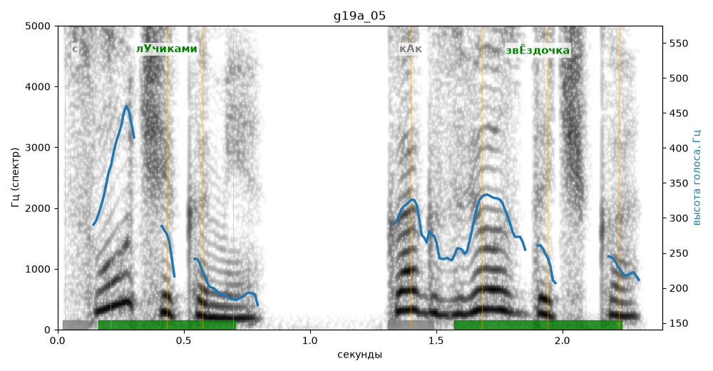

# g19a_05

Естественность (UTMOS): **3.77 из 5** (живой диктор ≈ 4–4.5)
Эталон: С лучиками? Как звёздочка?
Распознано: С лучиками, как звездочка.
Слова: все совпали

## Ударения
(где нужно: ruaccent)

| слово | нужно | у голоса | |
|---|---|---|---|
| лучиками | лУчиками | лУчиками | ✓ |
| звёздочка | звЁздочка | звЁздочка | ✓ |

## Интонация
- ✓ «с лучиками?» — вопросительный подъём на слове «лучиками»
- ✗ «как звёздочка?» — конец фразы не понижается — звучит незаконченно / как перечисление
- Диапазон голоса 13.8 полутонов (живо), средняя высота 261 Гц

## Паузы и темп
- паузы на своих местах
- Темп 5.6 слога/с (нормально)

_Синяя линия — высота голоса. Над словами заглавная буква — где ударение должно быть; красным — голос поставил не туда (уверенно), оранжевым — возможно._
