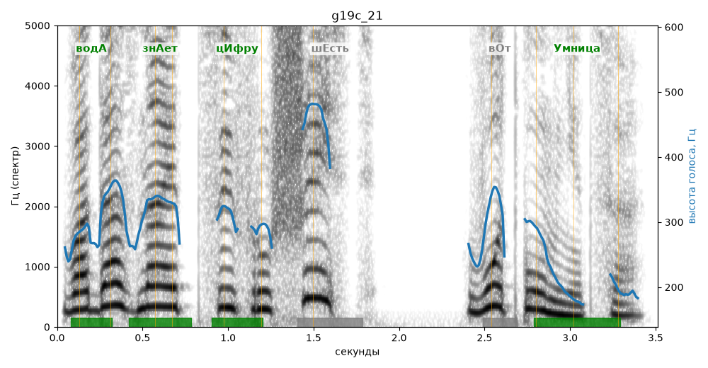

# g19c_21

Естественность (UTMOS): **3.5 из 5** (живой диктор ≈ 4–4.5)
Эталон: Вода знает цифру шесть? Вот умница!
Распознано: Вода знает цифру шесть. Вот умница.
Слова: все совпали

## Ударения
(где нужно: ruaccent)

| слово | нужно | у голоса | |
|---|---|---|---|
| вода | водА | водА | ✓ |
| знает | знАет | знАет | ✓ |
| цифру | цИфру | цИфру | ✓ |
| умница | Умница | Умница | ✓ |

## Интонация
- ✓ «вода знает цифру шесть?» — вопросительный подъём на слове «шесть»
- ✓ «вот умница!» — выделено слово «вот» (+4.6 пт)
- Диапазон голоса 15.9 полутонов (живо), средняя высота 291 Гц

## Паузы и темп
- паузы на своих местах
- Темп 4.8 слога/с (нормально)

_Синяя линия — высота голоса. Над словами заглавная буква — где ударение должно быть; красным — голос поставил не туда (уверенно), оранжевым — возможно._
