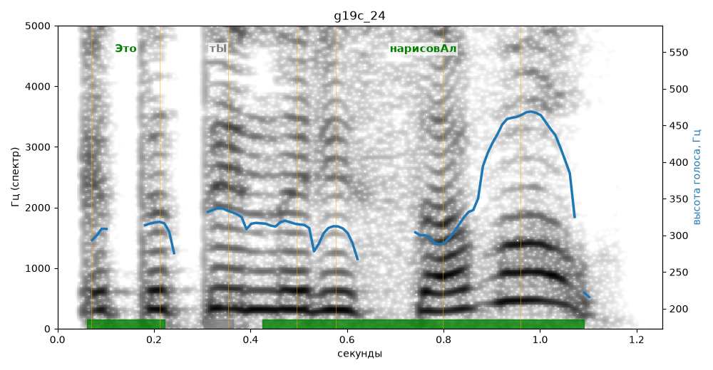

# g19c_24

Естественность (UTMOS): **2.76 из 5** (живой диктор ≈ 4–4.5)
Эталон: Это ты нарисовал?
Распознано: Это ты нарисовал?
Слова: все совпали

## Ударения
(где нужно: ruaccent)

| слово | нужно | у голоса | |
|---|---|---|---|
| это | Это | Это | ✓ |
| нарисовал | нарисовАл | нарисовАл | ✓ |

## Интонация
- ✓ «это ты нарисовал?» — вопросительный подъём на слове «нарисовал»
- Диапазон голоса 8.9 полутонов (живо), средняя высота 316 Гц

## Паузы и темп
- паузы на своих местах
- Темп 6.8 слога/с (быстро)

_Синяя линия — высота голоса. Над словами заглавная буква — где ударение должно быть; красным — голос поставил не туда (уверенно), оранжевым — возможно._
