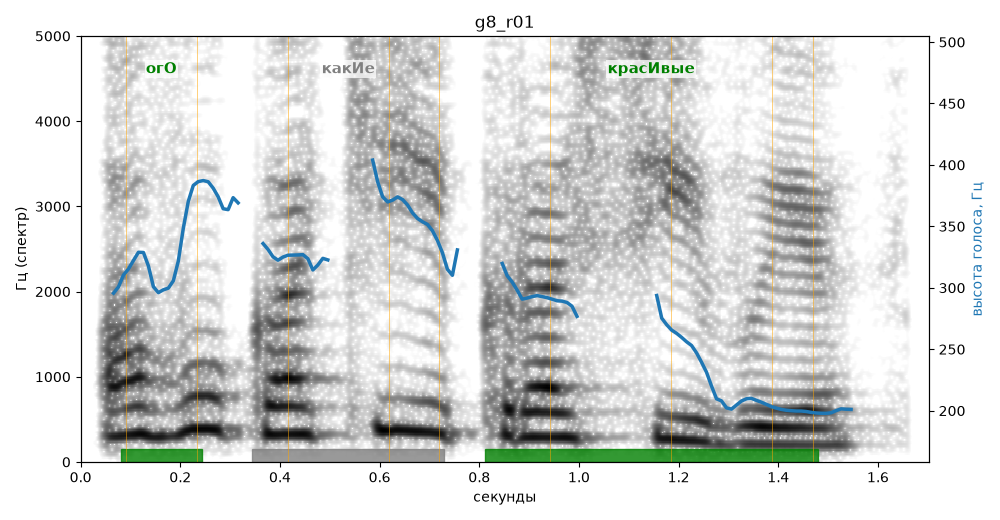

# g8_r01

Естественность (UTMOS): **3.27 из 5** (живой диктор ≈ 4–4.5)
Эталон: Ого! Какие красивые!
Распознано: А вот какие красивые!
Расхождения в словах: «ого» → «а вот»

## Ударения
(где нужно: ruaccent)

| слово | нужно | у голоса | |
|---|---|---|---|
| ого | огО | огО | ✓ |
| какие | какИе | кАкие | ? не разобрать |
| красивые | красИвые | красИвые | ✓ |

## Интонация
- ✓ «какие красивые!» — выделено слово «какие» (+4.2 пт)
- Диапазон голоса 11.2 полутонов (живо), средняя высота 300 Гц

## Паузы и темп
- после «ого!» пауза всего 0.10 с — фразы слипаются
- Темп 6.4 слога/с (нормально)

_Синяя линия — высота голоса. Над словами заглавная буква — где ударение должно быть; красным — голос поставил не туда (уверенно), оранжевым — возможно._
