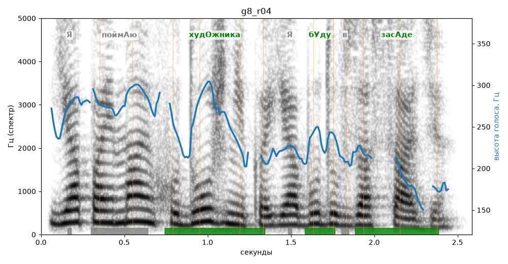

# g8_r04

Естественность (UTMOS): **3.43 из 5** (живой диктор ≈ 4–4.5)
Эталон: Я поймаю художника! Я буду в засаде.
Распознано: Я поймаю художника, я буду в засаде.
Слова: все совпали

## Ударения
(где нужно: ruaccent)

| слово | нужно | у голоса | |
|---|---|---|---|
| поймаю | поймАю | — | ? |
| художника | худОжника | худОжника | ✓ |
| буду | бУду | бУду | ✓ |
| засаде | засАде | засАде | ✓ |

## Интонация
- ✗ «я поймаю художника!» — восклицание звучит ровно, без эмоции
- ✓ «я буду в засаде.» — конец фразы понижается — звучит законченно
- Диапазон голоса 9.1 полутонов (живо), средняя высота 238 Гц

## Паузы и темп
- после «художника!» пауза всего 0.14 с — фразы слипаются
- Темп 5.4 слога/с (нормально)

_Синяя линия — высота голоса. Над словами заглавная буква — где ударение должно быть; красным — голос поставил не туда (уверенно), оранжевым — возможно._
