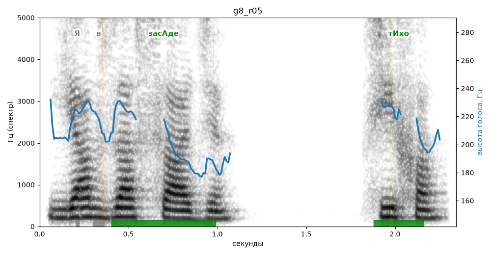

# g8_r05

Естественность (UTMOS): **2.87 из 5** (живой диктор ≈ 4–4.5)
Эталон: Я в засаде. Тихо!
Распознано: Я в засаде. Тихо.
Слова: все совпали

## Ударения
(где нужно: ruaccent)

| слово | нужно | у голоса | |
|---|---|---|---|
| засаде | засАде | засАде | ✓ |
| тихо | тИхо | тИхо | ✓ |

## Интонация
- ✓ «я в засаде.» — конец фразы понижается — звучит законченно
- Диапазон голоса 4.3 полутонов (монотонно, как робот), средняя высота 205 Гц

## Паузы и темп
- паузы на своих местах
- Темп 5.6 слога/с (нормально)

_Синяя линия — высота голоса. Над словами заглавная буква — где ударение должно быть; красным — голос поставил не туда (уверенно), оранжевым — возможно._
