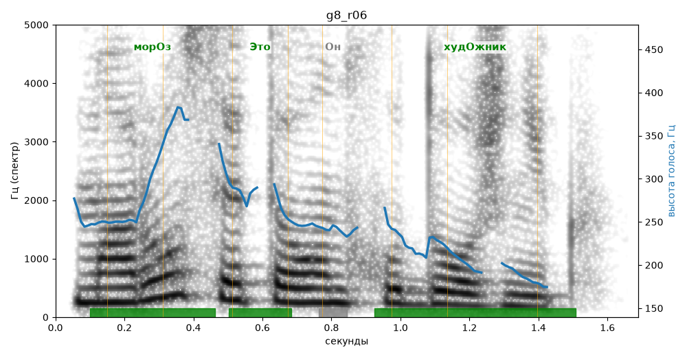

# g8_r06

Естественность (UTMOS): **2.96 из 5** (живой диктор ≈ 4–4.5)
Эталон: Мороз! Это он художник!
Распознано: Мороз это он художник.
Слова: все совпали

## Ударения
(где нужно: ruaccent)

| слово | нужно | у голоса | |
|---|---|---|---|
| мороз | морОз | морОз | ✓ |
| это | Это | Это | ✓ |
| художник | худОжник | худОжник | ✓ |

## Интонация
- ✓ «это он художник!» — выделено слово «это» (+3.4 пт)
- Диапазон голоса 11.6 полутонов (живо), средняя высота 246 Гц

## Паузы и темп
- после «мороз!» пауза всего 0.04 с — фразы слипаются
- Темп 5.7 слога/с (нормально)

_Синяя линия — высота голоса. Над словами заглавная буква — где ударение должно быть; красным — голос поставил не туда (уверенно), оранжевым — возможно._
