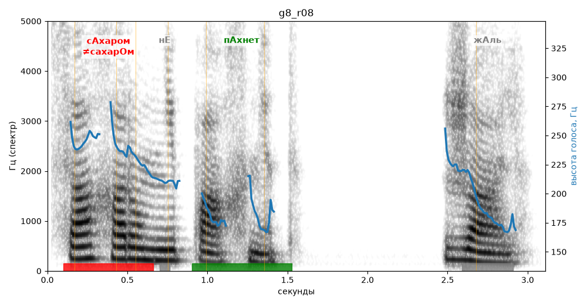

# g8_r08

Естественность (UTMOS): **2.4 из 5** (живой диктор ≈ 4–4.5)
Эталон: Сахаром не пахнет. Жаль.
Распознано: Сахаром не пахнет. Жаль.
Слова: все совпали

## Ударения
(где нужно: ruaccent)

| слово | нужно | у голоса | |
|---|---|---|---|
| сахаром | сАхаром | сахарОм | ✗ ОШИБКА |
| пахнет | пАхнет | пАхнет | ✓ |

## Интонация
- ✓ «сахаром не пахнет.» — конец фразы понижается — звучит законченно
- Диапазон голоса 6.9 полутонов (нормально), средняя высота 211 Гц

## Паузы и темп
- паузы на своих местах
- Темп 4.0 слога/с (нормально)

_Синяя линия — высота голоса. Над словами заглавная буква — где ударение должно быть; красным — голос поставил не туда (уверенно), оранжевым — возможно._
