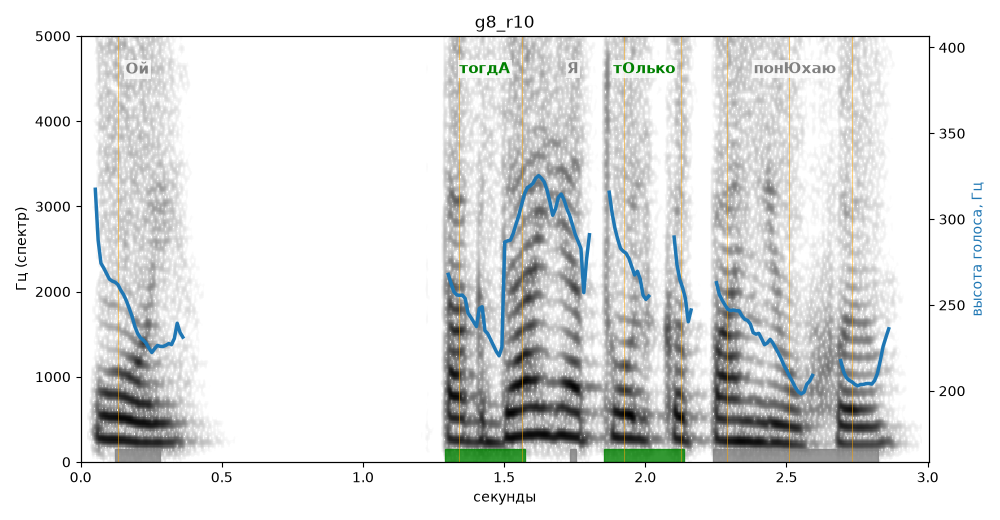

# g8_r10

Естественность (UTMOS): **2.71 из 5** (живой диктор ≈ 4–4.5)
Эталон: Ой. Тогда я только понюхаю.
Распознано: Ой, тогда я только понюхаю.
Слова: все совпали

## Ударения
(где нужно: ruaccent)

| слово | нужно | у голоса | |
|---|---|---|---|
| тогда | тогдА | тогдА | ✓ |
| только | тОлько | тОлько | ✓ |
| понюхаю | понЮхаю | — | ? |

## Интонация
- ✓ «тогда я только понюхаю.» — конец фразы понижается — звучит законченно
- Диапазон голоса 7.6 полутонов (живо), средняя высота 247 Гц

## Паузы и темп
- паузы на своих местах
- Темп 5.2 слога/с (нормально)

_Синяя линия — высота голоса. Над словами заглавная буква — где ударение должно быть; красным — голос поставил не туда (уверенно), оранжевым — возможно._
