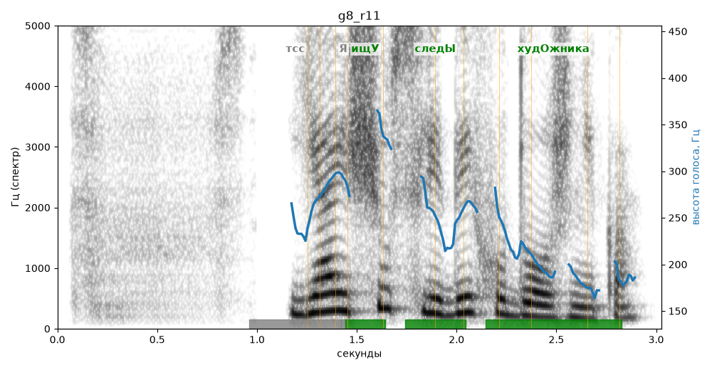

# g8_r11

Естественность (UTMOS): **3.58 из 5** (живой диктор ≈ 4–4.5)
Эталон: Тсс! Я ищу следы художника.
Распознано: Я ищу следы художника.
Расхождения в словах: «тсс» → «»

## Ударения
(где нужно: ruaccent)

| слово | нужно | у голоса | |
|---|---|---|---|
| ищу | ищУ | ищУ | ✓ |
| следы | следЫ | следЫ | ✓ |
| художника | худОжника | худОжника | ✓ |

## Интонация
- ✓ «я ищу следы художника.» — конец фразы понижается — звучит законченно
- Диапазон голоса 10.8 полутонов (живо), средняя высота 233 Гц

## Паузы и темп
- после «тсс!» пауза всего 0.00 с — фразы слипаются
- Темп 5.9 слога/с (нормально)

_Синяя линия — высота голоса. Над словами заглавная буква — где ударение должно быть; красным — голос поставил не туда (уверенно), оранжевым — возможно._
