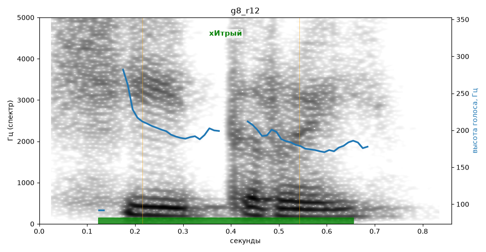

# g8_r12

Естественность (UTMOS): **2.68 из 5** (живой диктор ≈ 4–4.5)
Эталон: Хитрый.
Распознано: Хитрый.
Слова: все совпали

## Ударения
(где нужно: ruaccent)

| слово | нужно | у голоса | |
|---|---|---|---|
| хитрый | хИтрый | хИтрый | ✓ |

## Интонация
- Диапазон голоса 4.7 полутонов (нормально), средняя высота 191 Гц

## Паузы и темп
- паузы на своих местах
- Темп 3.8 слога/с (медленно)

_Синяя линия — высота голоса. Над словами заглавная буква — где ударение должно быть; красным — голос поставил не туда (уверенно), оранжевым — возможно._
