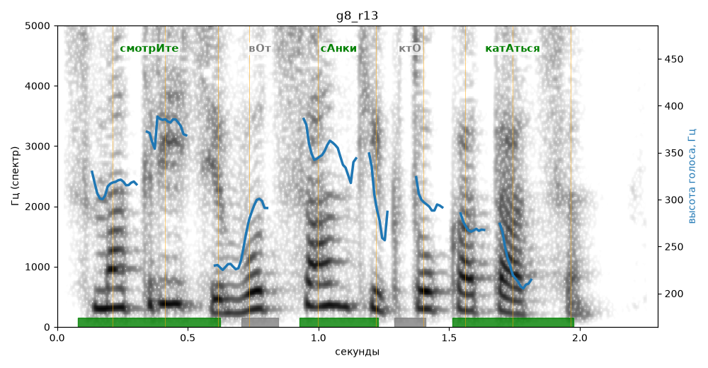

# g8_r13

Естественность (UTMOS): **3.14 из 5** (живой диктор ≈ 4–4.5)
Эталон: Смотрите, вот санки! Кто кататься?
Распознано: Смотрите, вот санки, кто кататься.
Слова: все совпали

## Ударения
(где нужно: ruaccent)

| слово | нужно | у голоса | |
|---|---|---|---|
| смотрите | смотрИте | смотрИте | ✓ |
| санки | сАнки | сАнки | ✓ |
| кататься | катАться | катАться | ✓ |

## Интонация
- ✓ «смотрите вот санки!» — выделено слово «смотрите» (+3.4 пт)
- ✓ «кто кататься?» — конец фразы понижается — звучит законченно
- Диапазон голоса 10.0 полутонов (живо), средняя высота 301 Гц

## Паузы и темп
- после «санки!» пауза всего 0.06 с — фразы слипаются
- Темп 5.3 слога/с (нормально)

_Синяя линия — высота голоса. Над словами заглавная буква — где ударение должно быть; красным — голос поставил не туда (уверенно), оранжевым — возможно._
