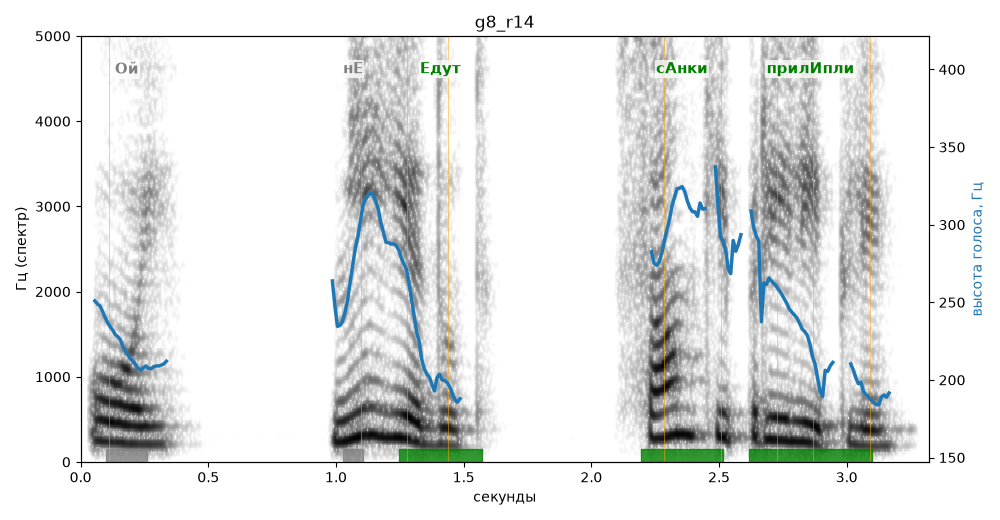

# g8_r14

Естественность (UTMOS): **2.89 из 5** (живой диктор ≈ 4–4.5)
Эталон: Ой. Не едут. Санки прилипли!
Распознано: Ой, не едут. Санки прилипли.
Слова: все совпали

## Ударения
(где нужно: ruaccent)

| слово | нужно | у голоса | |
|---|---|---|---|
| едут | Едут | Едут | ✓ |
| санки | сАнки | сАнки | ✓ |
| прилипли | прилИпли | прилИпли | ✓ |

## Интонация
- ✗ «не едут.» — конец фразы не понижается — звучит незаконченно / как перечисление
- ✓ «санки прилипли!» — выделено слово «санки» (+2.8 пт)
- Диапазон голоса 9.0 полутонов (живо), средняя высота 244 Гц

## Паузы и темп
- паузы на своих местах
- Темп 5.6 слога/с (нормально)

_Синяя линия — высота голоса. Над словами заглавная буква — где ударение должно быть; красным — голос поставил не туда (уверенно), оранжевым — возможно._
