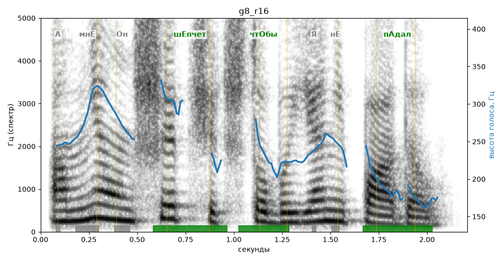

# g8_r16

Естественность (UTMOS): **3.71 из 5** (живой диктор ≈ 4–4.5)
Эталон: А мне он шепчет, чтобы я не падал.
Распознано: А мне он шепчет, чтобы я не падал.
Слова: все совпали

## Ударения
(где нужно: ruaccent)

| слово | нужно | у голоса | |
|---|---|---|---|
| шепчет | шЕпчет | шЕпчет | ✓ |
| чтобы | чтОбы | чтОбы | ✓ |
| падал | пАдал | пАдал | ✓ |

## Интонация
- ✓ «а мне он шепчет чтобы я не падал.» — конец фразы понижается — звучит законченно
- Диапазон голоса 10.6 полутонов (живо), средняя высота 241 Гц

## Паузы и темп
- паузы на своих местах
- Темп 5.1 слога/с (нормально)

_Синяя линия — высота голоса. Над словами заглавная буква — где ударение должно быть; красным — голос поставил не туда (уверенно), оранжевым — возможно._
