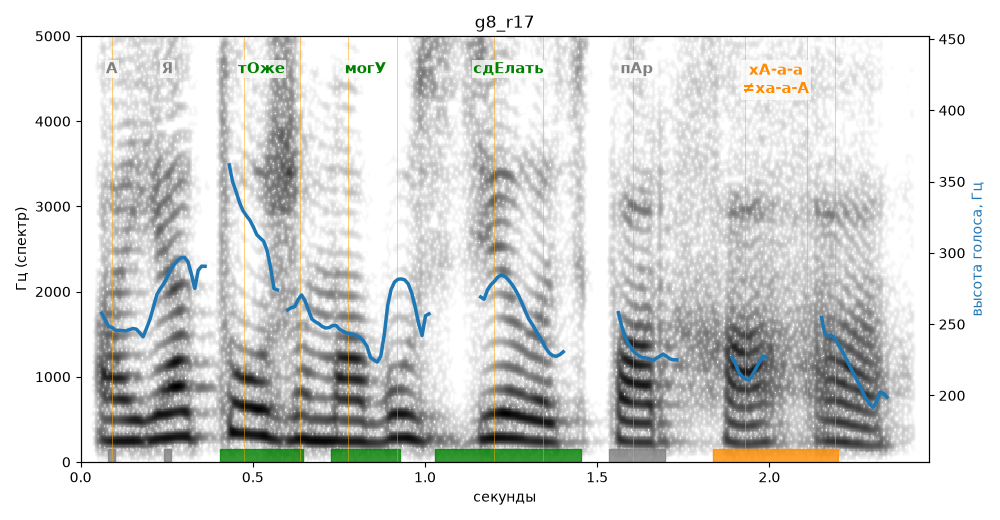

# g8_r17

Естественность (UTMOS): **2.56 из 5** (живой диктор ≈ 4–4.5)
Эталон: А я тоже могу сделать пар! Ха-а-а!
Распознано: А я тоже могу сделать пар-ха-ха.
Расхождения в словах: «пар ха-а-а» → «пар-ха-ха»

## Ударения
(где нужно: ruaccent)

| слово | нужно | у голоса | |
|---|---|---|---|
| тоже | тОже | тОже | ✓ |
| могу | могУ | могУ | ✓ |
| сделать | сдЕлать | сдЕлать | ✓ |
| ха-а-а | хА-а-а | ха-а-А | ✗? возможно — послушать |

## Интонация
- ✓ «а я тоже могу сделать пар!» — выделено слово «тоже» (+4.0 пт)
- Диапазон голоса 7.1 полутонов (живо), средняя высота 247 Гц

## Паузы и темп
- после «пар!» пауза всего 0.14 с — фразы слипаются
- Темп 5.2 слога/с (нормально)

_Синяя линия — высота голоса. Над словами заглавная буква — где ударение должно быть; красным — голос поставил не туда (уверенно), оранжевым — возможно._
