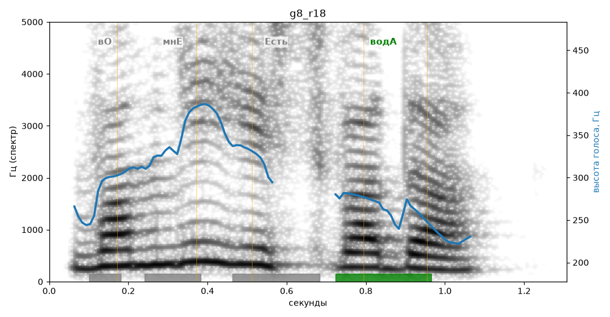

# g8_r18

Естественность (UTMOS): **3.04 из 5** (живой диктор ≈ 4–4.5)
Эталон: Во мне есть вода?
Распознано: Во мне есть вода.
Слова: все совпали

## Ударения
(где нужно: ruaccent)

| слово | нужно | у голоса | |
|---|---|---|---|
| вода | водА | водА | ✓ |

## Интонация
- ✓ «во мне есть вода?» — вопросительный подъём на слове «мне»
- Диапазон голоса 9.0 полутонов (живо), средняя высота 295 Гц

## Паузы и темп
- паузы на своих местах
- Темп 5.8 слога/с (нормально)

_Синяя линия — высота голоса. Над словами заглавная буква — где ударение должно быть; красным — голос поставил не туда (уверенно), оранжевым — возможно._
