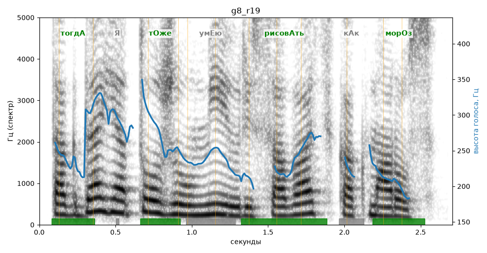

# g8_r19

Естественность (UTMOS): **3.37 из 5** (живой диктор ≈ 4–4.5)
Эталон: Тогда я тоже умею рисовать, как мороз!
Распознано: Тогда я тоже умею рисовать как мороз.
Слова: все совпали

## Ударения
(где нужно: ruaccent)

| слово | нужно | у голоса | |
|---|---|---|---|
| тогда | тогдА | тогдА | ✓ |
| тоже | тОже | тОже | ✓ |
| умею | умЕю | — | ? |
| рисовать | рисовАть | рисовАть | ✓ |
| мороз | морОз | морОз | ✓ |

## Интонация
- ✓ «тогда я тоже умею рисовать как мороз!» — выделено слово «тогда» (+4.4 пт)
- Диапазон голоса 7.4 полутонов (живо), средняя высота 241 Гц

## Паузы и темп
- паузы на своих местах
- Темп 4.9 слога/с (нормально)

_Синяя линия — высота голоса. Над словами заглавная буква — где ударение должно быть; красным — голос поставил не туда (уверенно), оранжевым — возможно._
